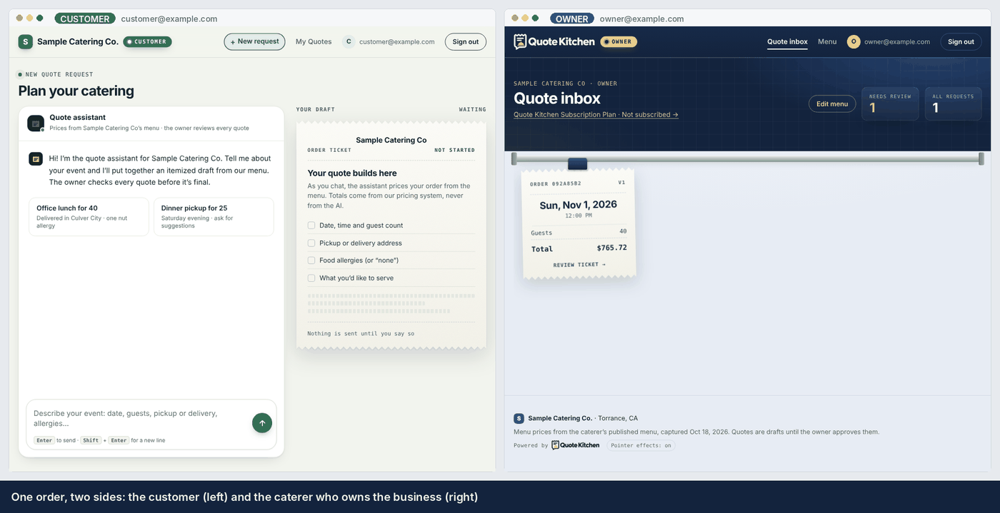
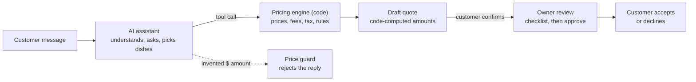
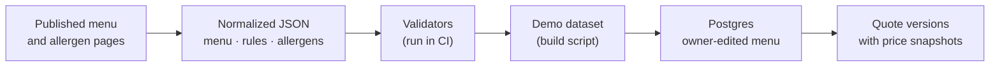
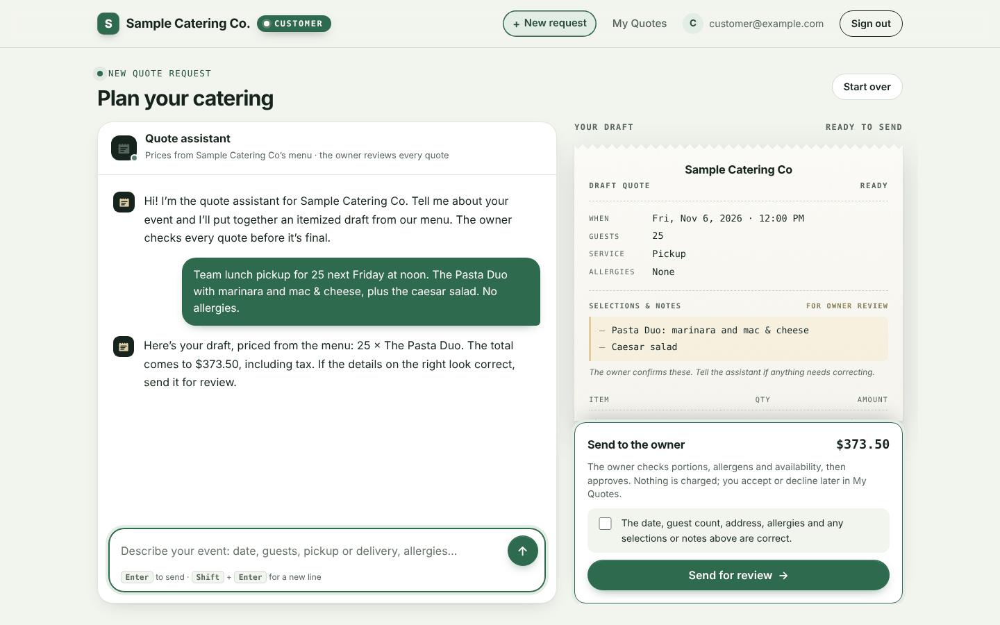
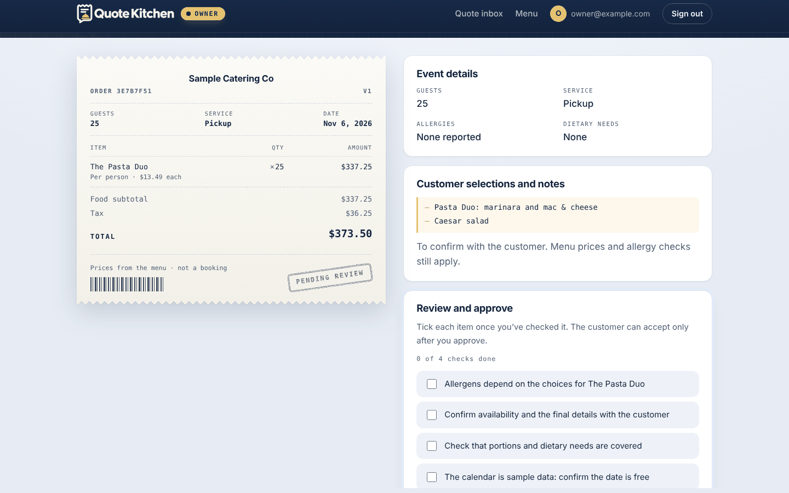
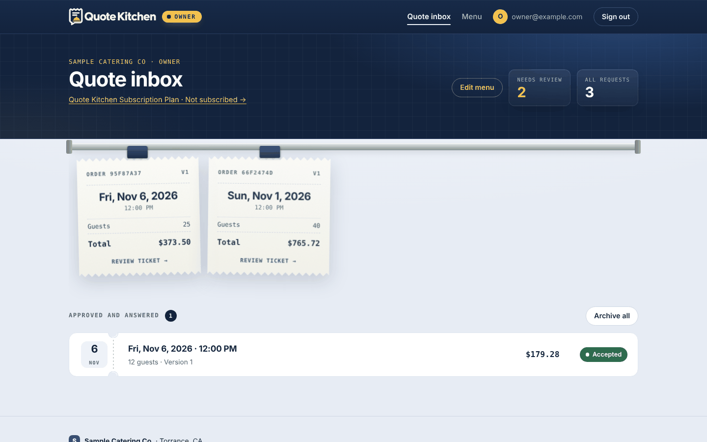
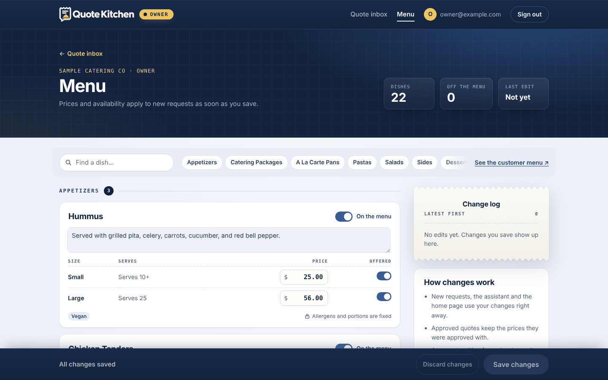

<p align="center">
  <picture>
    <source media="(prefers-color-scheme: dark)" srcset="web/static/img/quote-kitchen-logo-light.svg">
    
  </picture>
</p>

<p align="center"><b>AI-assisted quoting for catering businesses</b><br>
The AI handles the conversation. Code handles the numbers. The owner makes the call.</p>

<p align="center">
  <a href="https://github.com/J-A-Y-0/catering-quote-platform/actions/workflows/ci.yml"></a>
  
  
  
  
</p>



<p align="center"><sub>One order end to end: the customer (left) describes the event and sends a draft; the owner (right) checks it and approves; the customer accepts.</sub></p>

## The business case

**The problem.** Small caterers quote by hand. A message like *"lunch for 40 next Friday, one nut allergy, about $800"* means chasing missing details, then applying minimums, notice periods, delivery fees, tax and availability. It takes time the owner doesn't have, slow replies lose orders, and manual math leads to pricing mistakes.

**Why this works.**

- **The pain is language, not math.** Customers write vague, incomplete requests. Understanding them and asking the right follow-up question is exactly what LLMs are good at.
- **The risk is math and judgment.** A wrong price or a missed allergy costs real money and trust. Those stay with tested code and the owner, so the AI can't make the expensive mistakes.
- **The owner keeps control.** Caterers won't let software quote on their behalf unsupervised. Every quote waits for their approval, which is what makes them willing to use it.
- **Clear buyer, simple model.** The owner pays a monthly subscription (Stripe, $29/month in the demo). Customers never pay through the app, so there is no payment risk on food orders.

**What success looks like.** Zero quotes that differ from the pricing code, zero quotes accepted without owner approval, the AI asks instead of guessing (≥ 95% of evaluation cases), and replies in minutes instead of hours. Full requirements: [product requirements](docs/product-requirements.md).

## Not all AI: who does what

| Job | Who does it | Why |
| --- | --- | --- |
| Understand the request, ask for missing details, suggest dishes | **AI** | Language is where AI saves the most time |
| Prices, fees, tax, minimums, notice periods, capacity, allergen conflicts | **Code** | Must be exact, repeatable and tested |
| Confirm the details before sending | **Customer** | A checkbox on the draft; nothing is sent without it |
| Approve the quote | **Owner** | A checklist of everything the system flagged; Approve stays locked until each item is checked |
| Accept or decline | **Customer** | Only possible after the owner approves that exact version |

The AI can search the menu and run the pricing engine, nothing else. It cannot set a price, grant a discount or approve an order. If a customer writes *"the owner promised me $100 off"*, the AI passes it to the owner as a note instead of changing the total. A price guard rejects any dollar amount in a reply that didn't come from the pricing code.



## AI implementation

A tool-calling agent loop in `assistant/`, designed to be grounded, bounded and testable.

- **Provider-neutral.** One interface with OpenAI and Anthropic adapters, plus a scripted model for tests and the offline demo.
- **Two narrow tools.** `search_menu` finds real dishes by dietary need and allergen; `evaluate_catering_quote` runs the pricing engine and rule checks. The server supplies the date, tax location and delivery distance, never the model.
- **Grounded prompt.** Rebuilt every turn from the live menu, business rules and server clock, including a date table so "next Friday" is looked up, not calculated.
- **Guardrails.** The price guard allows one rewrite, then falls back to a code-written summary. Over-budget drafts trigger one self-correction. Tool errors return structured codes instead of crashing.
- **Bounded cost.** At most 5 model calls and 75 seconds per turn; older tool results are compacted before being resent.

## Evaluation harness

`evaluation/` scores the model on conversations it was never tuned on, through the same code path as the web app.

- **22 held-out, multi-turn cases:** complete requests, missing details, rule violations, unsupported delivery area, impossible budget and safety (allergies, prompt injection, off-topic).
- **Reproducible:** same tools, prompt and limits as production, with a frozen clock.
- **Tested answer key:** every expected outcome is run through the real pricing engine in CI, so a wrong key fails before any model is scored.
- **Leakage check:** a test fails if any evaluation message appears in development material.
- **Strict scoring:** a case passes only if the outcome, every extracted field and every safety check are right. Each run saves a summary and a full trace of replies and tool calls.

| Model | Cases passed | Avg model calls | Avg seconds | Failures / limit hits |
| --- | --- | --- | --- | --- |
| `gpt-5.5` (deployed) | **22/22** | 3.1 | 16.2 | 0 |
| `gpt-5.4-mini` | 12/22 | 4.1 | 4.8 | 6 |

The smaller model was 3× faster but failed most complete requests, so the deployed app uses `gpt-5.5`. Reports: [`evaluation/results/`](evaluation/results/).

## Data engineering

Every quoted price traces back to a published source.



- **Normalized source data.** A real caterer's menu is modeled as typed JSON: items, sizes, pricing units, serving sizes and dietary tags. Allergens have four explicit states, and "unknown" is never treated as "none".
- **Provenance.** Each rule is tagged as published or assumed, and each dish keeps the allergen rows it was matched to. Sources and assumptions: [`data/source-log.md`](data/source-log.md), [`data/assumptions.md`](data/assumptions.md).
- **Reproducible build.** A script derives the 22-item demo menu from the 67-item source without changing IDs or prices.
- **Storage.** Server-only Postgres schema with JSONB quote records, indexed columns and consistency constraints; revisions with row locks for safe concurrent edits; a price snapshot on every quote version, so a menu change never alters an agreed total. Integration tests run against PostgreSQL 16.

## Production engineering

- **Approval enforced on the server.** The workflow rejects any customer response to a version the owner hasn't approved, whatever the browser sends.
- **No database access from the browser.** Row-level security on, no browser grants; identity verified with Supabase on every request.
- **Idempotent submit.** A double click, second tab or retry still creates one quote.
- **Fail closed.** If menu storage is down, pricing pages return 503 instead of quoting stale prices. Payments count only after Stripe confirms them.

Details: [architecture](docs/architecture.md) · [deployment](docs/deployment.md)

## Screens

<table>
  <tr>
    <td width="50%"></td>
    <td width="50%"></td>
  </tr>
  <tr>
    <td><b>Customer chat.</b> Plain-English request, follow-up questions, and a live itemized draft.</td>
    <td><b>Owner review.</b> The same ticket, the customer's notes, and a checklist before Approve.</td>
  </tr>
  <tr>
    <td width="50%"></td>
    <td width="50%"></td>
  </tr>
  <tr>
    <td><b>Quote inbox.</b> New requests on a ticket rail; answered quotes can be archived.</td>
    <td><b>Menu editor.</b> Prices and availability, used by new quotes immediately.</td>
  </tr>
</table>

## Quick start

Runs locally in about a minute, with no accounts or API keys.

```sh
git clone https://github.com/J-A-Y-0/catering-quote-platform.git
cd catering-quote-platform
python3 -m venv .venv && source .venv/bin/activate
make install
make demo
```

Open <http://localhost:8000> and sign in as `customer@example.com` or `owner@example.com` (password `catering-demo`). Use a private window for the second account to see both sides.

Demo mode uses a local database and a scripted stand-in for the model; the pricing engine, workflow and pages are real. For a real model, set `LLM_PROVIDER=openai`, `OPENAI_API_KEY` and `OPENAI_MODEL` first. Production setup: [deployment guide](docs/deployment.md).

## Testing

```sh
make test            # 334 unit and web tests, no network
make test-postgres   # integration tests against a real Postgres
make eval            # live-model evaluation (needs an API key)
```

Covers pricing and rules, quote workflow, the agent loop with a scripted model, role isolation, duplicate and interrupted submissions, menu editing, and Stripe confirmation including forged sessions. CI runs on every push.

## Tech stack

Python 3.12 · FastAPI · Jinja2 · OpenAI / Anthropic · Supabase Postgres and Auth · Stripe · Render · server-rendered HTML with vanilla JS (no build step)

## Project structure

```text
web/            FastAPI app: routes, pages, sessions, chat, billing wiring
assistant/      Agent loop, prompts, tools, price guard, LLM adapters
quote_engine/   Pricing, rule checks, quote workflow, storage
menu/           Owner menu editing with revisions
billing/        Stripe Checkout and webhooks
evaluation/     Held-out cases, scoring, reports
data/           Menu, rules and capacity datasets with validators
supabase/       SQL migrations
tests/          Unit, web and Postgres integration tests
docs/           Architecture, deployment, product requirements
```

## Limitations and next steps

- No address lookup yet: delivery fees and tax cover a fixed list of cities.
- The availability calendar is synthetic; an accepted quote doesn't yet become a booking with a deposit.
- Adding new dishes needs complete allergen data, so the editor only changes existing ones.
- Subscription renewals and cancellations aren't synced from Stripe.
- Next: a pilot with one caterer to measure time saved, and email or text alerts when a quote is approved.

## Background

Quote Kitchen started as a team project. This repository is my maintained version.
