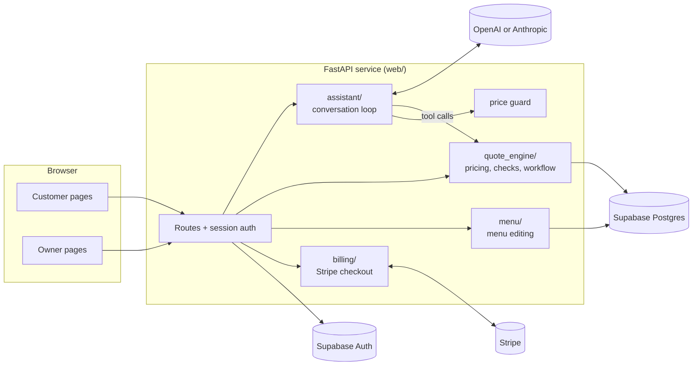

# Architecture

Quote Kitchen is one Python web service. A language model handles the conversation, deterministic code handles every number and business rule, and the business owner approves each quote before the customer can accept it.

## Modules

| Package | Responsibility |
| --- | --- |
| `web/` | FastAPI app: routes, server-rendered Jinja2 pages, session cookies, role checks, chat persistence, archive, Stripe wiring |
| `assistant/` | Provider-neutral conversation loop, system prompt, menu search tool, price guard, OpenAI and Anthropic adapters |
| `quote_engine/` | Pricing (`calculate_quote`), readiness checks (lead time, capacity, allergens, minimums), quote workflow and versioning, SQLite and Postgres storage |
| `menu/` | Owner menu edits with field validation, revisions and a change log |
| `billing/` | Stripe Checkout session creation, confirmation and webhook verification |
| `evaluation/` | Held-out conversation set, scoring and reports for the live model |
| `data/` | Menu, rules and capacity datasets, with validators |
| `supabase/migrations/` | Server-only schema for quotes, menus, conversations, billing and archive |

## How a quote moves through the system

1. **Customer message → assistant.** `web/chat.py` saves the message, then runs one turn of `assistant.Conversation`. The system prompt is rebuilt every turn from the server clock and the owner's current menu, including a date table so "next Friday" is a lookup rather than model arithmetic.
2. **Assistant → tools.** The model can only call two tools: `search_menu` to find real item and size IDs, and `evaluate_catering_quote`, which runs the pricing engine and readiness checks. The server supplies the time, tax location and delivery distance; the model cannot.
3. **Price guard.** Any dollar amount in the model's reply that did not come from a tool result, the customer or the server prompt is rejected. The model gets one chance to rewrite; otherwise a code-written summary is sent.
4. **Draft → submit.** The draft panel shows code-computed amounts only. Submit is allowed only when the latest evaluation has every required detail and nothing blocking, and the customer confirms the details. The quote ID is derived from the conversation ID, so a double click, a second tab or a retry can never create two quotes.
5. **Owner review.** The quote page lists what the engine flagged (allergens that depend on choices, capacity, portions). Approve stays locked until the owner ticks each item; the server checks the ticked codes and the displayed revision again.
6. **Customer response.** The customer can accept or decline only the approved version. Every version keeps a snapshot of the prices it used, so a later menu change never alters an agreed total.

## Key design decisions

- **No arithmetic in the model.** Prices, fees, tax, minimums and notice periods live in `quote_engine` and are covered by unit tests. The model's job is language: understanding, asking, choosing items.
- **Human approval is enforced by the workflow, not the UI.** `QuoteService` refuses customer acceptance of anything the owner has not approved, whatever the browser sends.
- **Server-only data access.** All tables live in a private schema with row-level security on and no grants to browser roles. The browser never talks to the database; identity comes from Supabase verifying the access token on every request, and roles come from server configuration (`OWNER_USER_IDS`), never from a form field.
- **Optimistic concurrency.** Quotes, menus and conversations carry a revision. Saves check it inside a row-locked transaction, so a second tab can't overwrite newer changes.
- **Fail closed.** If the menu database is unreachable, pages that price return 503 instead of quoting from a stale menu. Stripe payments are recorded only after Stripe confirms them (success-page lookup or signature-checked webhook), never from a redirect URL.
- **Cost limits per turn.** Each reply may call the model at most 5 times within 75 seconds, messages are capped at 1,200 characters and 15 per request, and customers are rate-limited per minute. Optional daily caps are environment variables.
- **One service, no frontend build.** Server-rendered pages with small vanilla JavaScript modules. Pages work without JavaScript; the chat upgrades to in-place updates when it is available.

## Security checklist

- Session cookies are `HttpOnly`, `SameSite=Lax` and `Secure` in production; sign-out revokes the session in Supabase.
- Cross-site form posts are refused by an `Origin`/`Referer` check (the Stripe webhook is the only exemption and is signature-verified).
- Another account's quote returns the same 404 as a missing one; signed-in pages are `Cache-Control: no-store`.
- Notices after actions travel in a one-time cookie, so a link cannot fake "Quote approved".
- Secrets live only in the hosting environment; `.env` is ignored and `.env.example` lists names only.

## Front end

- **Two clearly separated roles.** Customers see the caterer's brand on a light, green theme; the owner works in a navy "kitchen office" theme branded Quote Kitchen. Role labels in the header and tab titles make the two sides easy to tell apart side by side.
- **Order ticket as the signature element.** Quotes render as thermal-paper tickets with torn edges, a barcode and an inked status stamp, used on the home page, chat draft, quote pages and owner inbox.
- **Quality floor.** No horizontal scroll from 320 px to desktop, visible keyboard focus, text contrast of at least 4.5:1, and all animation off under `prefers-reduced-motion`.

## Data

The demo dataset (`data/demo/`) is a frozen 22-item menu derived from a real caterer's published menu, shown under the generic name "Sample Catering Co.". Unpublished rules (such as the delivery fee) are documented assumptions in [`data/assumptions.md`](../data/assumptions.md), and the availability calendar is synthetic. Sources are listed in [`data/source-log.md`](../data/source-log.md).
